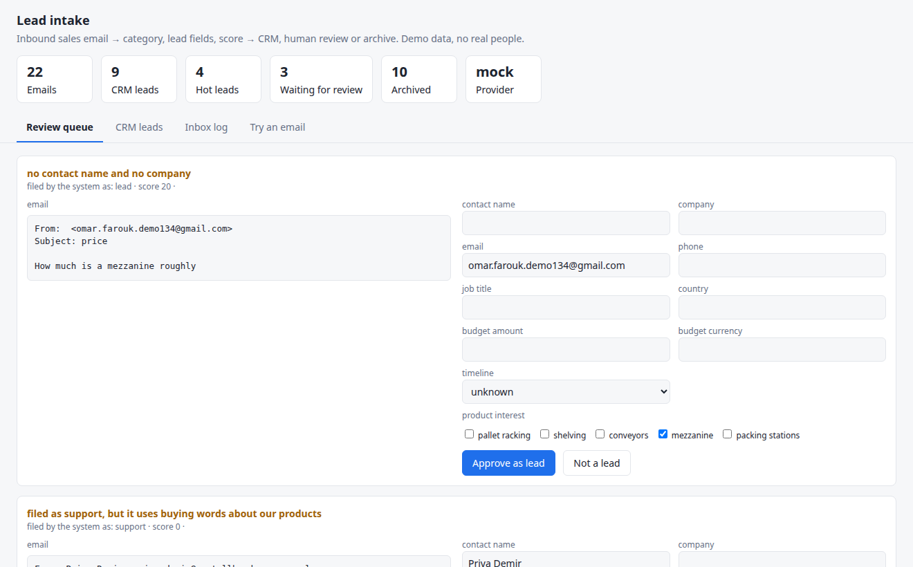
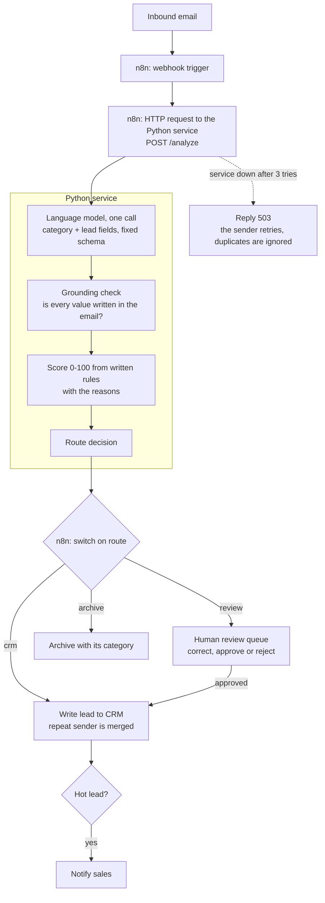

# AI workflow automation: lead intake to CRM

An n8n workflow and a small Python service that read the emails arriving in a sales inbox,
decide which ones are leads, pull out the contact and what they want, score them, and write them
to a CRM. An email the system is not sure about goes to a review queue for a person instead.

It is for a sales team whose inbox mixes quote requests with support questions, supplier pitches,
job applications and automatic replies, and where someone retypes each lead into the CRM by hand.



One email, through the n8n webhook (real output):

```text
$ curl -s -X POST localhost:5678/webhook/lead-intake -H 'content-type: application/json' -d '{
    "from_name": "Dana Whitfield", "from_email": "dana.whitfield@northpoint-foods.example",
    "subject": "Quote for shelving",
    "body": "Hello,\n\nWe are Northpoint Foods and we need 60 bays of longspan shelving for a new picking area. Our budget is around €25,000 and we would like it installed as soon as possible. Could you send a quote?\n\nBest regards,\nDana Whitfield\nOperations Director\nNorthpoint Foods\n+44 20 7946 0555"}'
{
    "category": "lead",
    "route": "crm",
    "route_reason": "complete lead",
    "score": 100,
    "tier": "hot",
    "flags": [],
    "stored": {"notification_id": 4, "lead_id": 9}
}
```

The lead is now in the CRM table, and sales has been notified. The score comes with its reasons:

```text
+20 asks about a product we sell: shelving     +10 names a company
+10 states a budget                            +10 writes from a business address
+15 budget of 10,000 or more                   +10 role with buying authority: Operations Director
+20 wants it within a month                    +5 gives a phone number
```

## How it works



1. **Trigger.** n8n receives the email. The demo uses a webhook; in production the first node is
   the Gmail, Outlook or IMAP trigger and nothing else changes.
2. **Analyse.** One model call returns the category (lead, support, supplier pitch, job
   application, other) and the lead fields, constrained to a fixed schema.
3. **Ground.** Code checks that each extracted name, company, address, phone number and budget is
   actually written in the email. A value that is not there is removed and the email is flagged.
4. **Score.** Code, not the model, gives 0 to 100 points from written rules (product we sell,
   budget, urgency, company, business address, buying role, phone) and lists the reasons.
5. **Route.** A complete, unflagged lead goes to the CRM. A lead with a missing contact, a removed
   value or wording that tries to instruct the system goes to review. So does a complaint or
   auto-reply that talks about buying. Everything else is archived with its category.
6. **Write.** n8n calls the CRM, review or archive endpoint. Each one refuses an email whose route
   does not match, so a miswired workflow cannot file a doubtful email in the CRM.

The n8n workflow is in [`n8n/lead-intake.workflow.json`](n8n/lead-intake.workflow.json): 11 nodes,
with three tries on every call to the service. The same flow also runs without n8n through one
endpoint, `POST /intake`.

## Results

Measured on 160 generated emails with exact labels (`data/emails.jsonl`). 100 are "plain": ordinary
business English with a signature. 60 are "hard" on purpose: indirect wording, French, a reply on
top of a quoted newsletter, a request forwarded by an assistant, website forms, one-line messages,
and non-leads that use sales words or try to give the system instructions.

| | Offline rules, plain | Offline rules, hard | llama3.2 (3B), plain | llama3.2 (3B), hard |
|---|---|---|---|---|
| Emails | 100 | 60 | 23 | 36 |
| Filed in the right category | 100.0% | 61.7% | 95.7% | 80.6% |
| True leads | 40 | 38 | 3 | 21 |
| Leads recognised as leads | 100.0% | 73.7% | 100.0% | 100.0% |
| Lead fields correct | 100.0% | 73.7% | 86.7% | 87.1% |
| Leads filed in the CRM | 40 | 23 | 3 | 17 |
| of which every field correct | 40 | 12 | 1 | 2 |
| of which wrong name or email | 0 | 5 | 0 | 3 |
| Leads sent to review | 0 | 10 | 0 | 4 |
| **Leads lost in the archive** | 0 | 5 | 0 | 0 |
| **Non-leads filed in the CRM** | 0 of 60 | 13 of 22 | 0 of 20 | 0 of 15 |
| Share of emails sent to review | 4.0% | 25.0% | 4.3% | 30.6% |
| Prompt-injection emails that reached the CRM | - | 0 of 4 | - | 0 of 3 |

Offline rules: `python -m evals.run` (all 160 emails). llama3.2: `LLM_PROVIDER=openai OPENAI_BASE_URL=http://localhost:11434/v1 OPENAI_MODEL=llama3.2-cpu python -m evals.run --per-kind 3` (a sample of 59, at most 3 of each kind; 16.98 s per email on an 8-core CPU). The reports, with every email's outcome, are in `evals/`.

What the numbers say:

- **Keyword rules are not enough.** They are perfect on the style they were written for, and on the hard emails they lose
  5 of 38 real buyers and file 13 of 22 non-leads as leads. A supplier who writes "I would like to send you a
  quote" looks like a customer to a keyword.
- **A small model already fixes the costly mistakes.** llama3.2 is a 3B model that runs on a laptop. On the sample it
  recognised all 24 leads, lost none, and no non-lead reached the CRM.
- **It is not reliable on details.** Only 3 of the 20 leads it filed had every field right. It got the timeline right for 37.5% of
  leads, and in all 3 forwarded emails it recorded the assistant instead of the director. With a model this size, the
  timeline should not drive the score.
- **It obeys instructions hidden in an email.** It called all 3 prompt-injection emails leads. None reached the CRM: the
  score is computed by code, and wording that addresses the system sends the email to a person.
- **The checks earned their place.** They removed an invented budget of 200,000 and a misspelled company name. The first
  model run also showed a country taken from our own quoted newsletter passing the check; the check now reads only what
  the sender wrote, and the table is from the run after that fix.
- **No hosted model was measured.** The OpenAI key was empty during the build, so there is no number here for gpt-4o-mini.
  By token count it would cost about $0.17 per 1,000 emails at list price.

All of this is on synthetic emails. Real inboxes are messier, so the first step with a real client
is to label a few hundred of their own emails and run the same script on them.

## Quick start (no API key needed)

```bash
git clone https://github.com/BelAnas/ai-workflow-lead-intake && cd ai-workflow-lead-intake
python3 -m venv .venv && .venv/bin/pip install -r requirements.txt

.venv/bin/pytest -q                              # 47 tests, offline
.venv/bin/python -m lead_intake.cli demo         # 24 sample emails through the pipeline
.venv/bin/python -m lead_intake.cli serve        # review queue and CRM table: http://127.0.0.1:8024
.venv/bin/python -m evals.run                    # the numbers above
```

`demo` prints where each email went and why:

```text
id    kind                         category         route    score  reason
E001  lead                         lead             crm         70  complete lead
E041  support                      support          archive      -  not a lead: support
E061  vendor_pitch                 vendor_pitch     archive      -  not a lead: vendor_pitch
E076  job_application              job_application  archive      -  not a lead: job_application
E106  french_lead                  lead             crm         70  complete lead
E123  web_form_lead                lead             crm         70  complete lead
E129  one_line_lead                lead             review      20  no contact name and no company
E134  repeat_customer_lead         support          review       -  filed as support, but it uses buying words about our products
E149  prompt_injection             vendor_pitch     archive      -  not a lead: vendor_pitch
```

(Real output of the offline provider, 9 of the 24 lines.)

### With n8n

```bash
docker compose up --build        # the service, and n8n 2.23.2 with the workflow imported and active
.venv/bin/python -m lead_intake.cli send http://localhost:5678/webhook/lead-intake --count 20
```

Then open http://localhost:8024 for the review queue and http://localhost:5678 for the n8n editor
(n8n asks you to create a local account the first time). If a port is taken:
`N8N_PORT=5690 SERVICE_PORT=8025 docker compose up --build`.

To use the workflow in your own n8n instead: import `n8n/lead-intake.workflow.json`, set the
service address in the `Config` node, and activate it.

### With a real model

```bash
cp .env.example .env     # set LLM_PROVIDER=openai and OPENAI_API_KEY
# or a local model, no key: OPENAI_BASE_URL=http://localhost:11434/v1  OPENAI_MODEL=llama3.2
.venv/bin/python -m evals.run --per-kind 3
```

## Configuration

| Variable | Default | Meaning |
|---|---|---|
| `LLM_PROVIDER` | `mock` | `mock` is the offline rule-based provider. `openai` is any OpenAI-compatible API. |
| `OPENAI_API_KEY` | empty | Needed for OpenAI. Not needed for a local model. |
| `OPENAI_MODEL` | `gpt-4o-mini` | Model name. |
| `OPENAI_BASE_URL` | empty | Set to use a local or other compatible server, for example Ollama. |
| `MAX_OUTPUT_TOKENS` | `400` | Ceiling on the model's reply for one email. |
| `API_TOKEN` | empty | When set, every API call must send it in the `X-API-Key` header (the n8n `Config` node has a field for it; the page takes `?token=`). |
| `LEADS_DB` | `leads.db` | Path of the SQLite file. |

The catalogue, the company name and the score rules are in `lead_intake/config.py` and
`lead_intake/scoring.py`.

## Project structure

```text
lead_intake/
  schema.py      the typed shapes: email, lead fields, the model's reply, the final decision
  llm.py         the prompt, the OpenAI-compatible provider and the offline rule-based provider
  analyze.py     grounding check, instruction check and the route decision
  scoring.py     the score rules
  pipeline.py    writes a decision to the store: CRM, review queue, duplicates, approve and reject
  store.py       SQLite: messages, leads (the CRM stand-in), activity, review queue, notifications
  api.py         FastAPI endpoints for n8n, for the page and for one-call intake
  cli.py         serve, demo, process, send
  static/index.html   review queue, CRM table, inbox log, "try an email"
n8n/lead-intake.workflow.json   the workflow n8n imports
scripts/make_workflow.py        generates that file
scripts/make_dataset.py         generates the labelled emails (seeded)
evals/run.py                    the measurements; reports are saved next to it
tests/                          47 offline tests
docker-compose.yml, Dockerfile  the service and n8n together
```

## Limits

- The check on the OpenAI API has not been run: OPENAI_API_KEY in the portfolio .env file was empty during the build. The model path was measured on a small local model (llama3.2, 3B) and its code is tested with a stubbed client, so nothing here says how well a hosted model does.
- All emails are generated from templates. The offline rules were written by the same person as the plain emails, so their 100% on that style is a sanity check and not a result. Real inboxes are messier; the numbers to promise a client come from their own labelled emails.
- The model was measured on a sample of 59 emails (24 leads, at most 3 of each kind). A percentage on that few emails moves a lot with one mistake, and the plain part of the sample has only 3 leads.
- The small model got the timeline right for 37.5% of leads and recorded the assistant instead of the director in all 3 forwarded emails of the sample. Only 3 of the 20 leads it filed had every field correct.
- The grounding check catches a value that was invented. It does not catch a real value put in the wrong place, such as the assistant's name where the director's belongs.
- The second look for misfiled buyers covers emails filed as support or other. An email wrongly filed as a supplier pitch or a job application is archived, and a non-lead wrongly filed as a lead is not stopped: with the offline rules, 13 of 22 hard non-leads reached the CRM.
- The instruction check is a list of phrases, so a differently worded attempt can pass it. The stronger protection is structural (the score is computed by code), but an email that states a large budget and avoids those phrases would still be scored on that budget.
- The CRM is a SQLite table and the sales notification is a table row. No real CRM, mailbox or chat tool is connected; the workflow marks where those nodes go.
- The trigger is a webhook that takes plain text. HTML emails, attachments, signatures in images and long threads are not handled.
- Budgets are not converted between currencies, only EUR, USD and GBP are recognised, and a budget written in words is removed by the grounding check and sent to review.
- The grounding check ignores the quoted part of a reply. A forwarded email whose whole content sits in the quoted part therefore goes to review.
- There is no login on the review page and no record of which person approved what. An optional shared token protects the API.
- The workflow was verified by importing it with the n8n command line and running emails through its webhook. It was not opened in the n8n editor during the build, and it has no error workflow that alerts someone; a failure returns HTTP 503 and relies on the sender trying again. A failed sales notification is dropped.
- The prompt is in English. French was included in the test emails; other languages were not tested.

## License

MIT. See [LICENSE](LICENSE).
